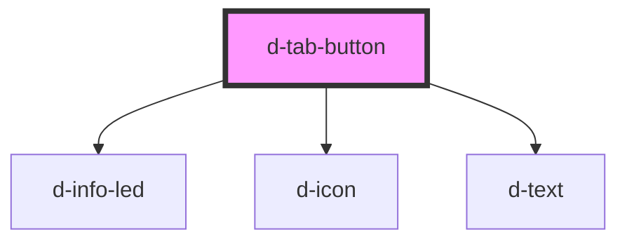

# d-tab-button

<!-- Auto Generated Below -->

## Properties

| Property          | Attribute          | Description | Type                                            | Default     |
| ----------------- | ------------------ | ----------- | ----------------------------------------------- | ----------- |
| `accessibleLabel` | `accessible-label` |             | `string`                                        | `undefined` |
| `active`          | `active`           |             | `boolean`                                       | `false`     |
| `focusIndex`      | `focus-index`      |             | `number`                                        | `0`         |
| `hasAlert`        | `has-alert`        |             | `boolean`                                       | `false`     |
| `href`            | `href`             |             | `string`                                        | `undefined` |
| `tab`             | `tab`              |             | `"activity" \| "home" \| "profile" \| "wallet"` | `undefined` |

## Methods

### `focusTab() => Promise<void>`

#### Returns

Type: `Promise<void>`

## Dependencies

### Depends on

- [d-info-led](../info-led)
- [d-icon](../icon)
- [d-text](../text)

### Graph

----------------------------------------------

*Built with [StencilJS](https://stenciljs.com/)*
